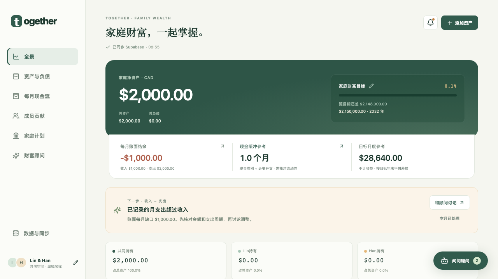

# 功能验证记录

验证日期：2026-10-13（America/Toronto）。

本次验证共 128 项通过：97 项单元 / 组件测试、28 项桌面与手机交互测试（包含真实 Supabase 双成员同步与只读家庭检查）、1 项真实 Supabase 数据库集成测试、2 项真实 OpenAI 请求测试（授权聊天与主动周报）。生产构建和 TypeScript 检查通过。

新增覆盖：新设备自动连接共同家庭；本机 / 云端差异暂停同步；损坏本机不上传空数据；云端保存后丢失确认可安全恢复；只保留聊天的本机记录合并；新建 / 搜索 / 回看 / 继续对话；异步回复保存在原对话；伴侣各自阅读位置独立；完整历史导出恢复。原有登录白名单、数据库隔离、限流、密码恢复与安全 Markdown 测试继续通过。

| 范围 | 已实际验证的行为 |
| --- | --- |
| 本年回报 | 从表格直接进入编辑；负数、零、清空都可保存；刷新后保持 |
| 资产与负债 | 自定义项目增删改；金额保留分；净资产正确扣负债；删空后不重建示例资产 |
| 图表 | 自定义类别准确汇总；成员 / 共同金额占比以总资产为分母；按日期筛选历史 |
| 成员贡献 | 投入与取出分别统计；关联账户金额联动；编辑只应用差额；删除撤回资金变动；独立历史出资不重复增加估值 |
| 成员名称 | 改名后，资产归属、贡献与占比仍对应同一成员 |
| 现金流与规划 | 每月项目增删改并持久化；必要开支自动更新应急金目标；账户清单自动联动 |
| 本机保存 | 重挂载、刷新和重新打开恢复数据；聊天与模型偏好保持；写入失败不更新界面为成功 |
| 自动连接 | 全新浏览器登录两位成员均加载同一家庭；读取不改写真实文档；冲突明确提示，不静默覆盖 |
| 聊天历史 | 新建保留旧对话；搜索与继续提问；刷新与跨设备恢复；所选对话上下文与其他对话隔离 |
| 历史与备份 | 同一天多次变化分别留存；JSON 备份导出与恢复；拒绝坏备份；损坏主数据保留并可恢复上一版本 |
| AI 数据操作 | 实际本地 API 修改回报并保存；多类动作一次性校验；错误金额 / 同名歧义拒绝；分析与假设不产生写操作 |
| 多模型 | OpenAI / Anthropic / DeepSeek 自动分档与手动选择的适配逻辑；provider 失败返回错误；OpenAI 真实请求返回有效答案 |
| Supabase | 两个授权账户登录、创建与加入临时家庭、共享数据；云端版本冲突拒绝；白名单外账号及非成员 RLS 隔离；文档修改历史保留 |
| 夫妻页面同步 | 两个独立登录会话通过页面共享家庭；一方修改回报另一方同步看到；刷新后重新连接并恢复 |
| 主动提醒 | 周报使用真实净资产；定时任务必须授权；订阅必须登录；已发送订阅按周去重；推送订阅 RLS 隔离 |
| 关键指标与洞察 | 月结余、现金覆盖、目标基线来自统一记录；缺失收支不伪造结余；记录变化不当作收益；点击归属筛选账户；现金指标展开应急金 |
| 主动顾问 | 待讨论数量与提示联动；已处理同月不重复；关闭偏好刷新后保持；手机无横向溢出且不弹遮挡提示；周报失败降级为规则内容，重复任务不重复调用 AI；锁屏通知不含金额 |

所有写入测试使用合成资产和隔离的临时家庭，结束后清理测试对象。真实家庭检查仅登录、读取和比较版本，确认文档未改写。保留两位真实账号，不发送注册邮件或重置测试邮件，不把私人财富数据放入源码、截图或测试样例。

## 复现

```bash
npm test
npm run build
NEXT_DIST_DIR=.next-test npm run build
npm run test:e2e
npm run test:cloud
npm run test:ai
npm run test:e2e:cloud
```

默认测试跳过真实外部测试，需要通过对应命令显式启用。真实 OpenAI 测试会使用已配置 key 并产生少量 API 费用。

## 验证边界

Anthropic 与 DeepSeek 尚未配置真实 key，已通过适配器 mock 测试，未声称真实调用成功。Web Push 的定时生成、授权、存储与去重已测试；实际设备投递需要用户在自己的浏览器主动启用通知。Vercel 上的周期任务和页面关闭后的真实投递，需要部署后配置同一组环境变量再启用订阅，不能用本机测试替代。

用户选择先上线登录限制，保留默认邮件提供方限制。邮件申请 UI、恢复令牌验证与密码更新逻辑已测试，但没有声称两位真实邮箱都已成功收信。可靠的双成员邮件恢复仍需自定义 SMTP。

## 界面

下面是浏览器测试生成的截图，金额与成员是测试数据。


