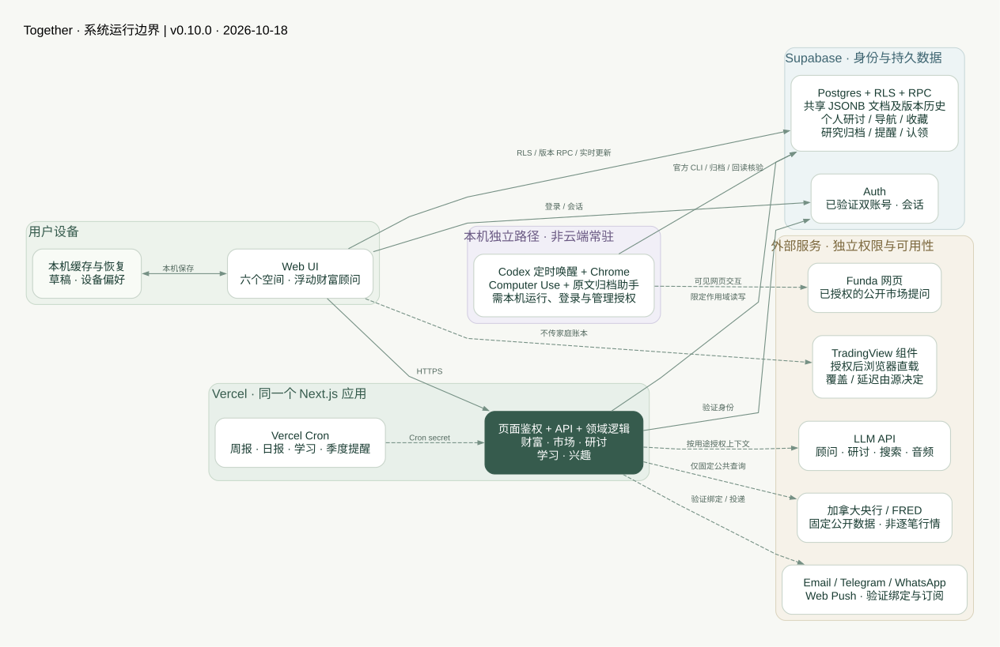
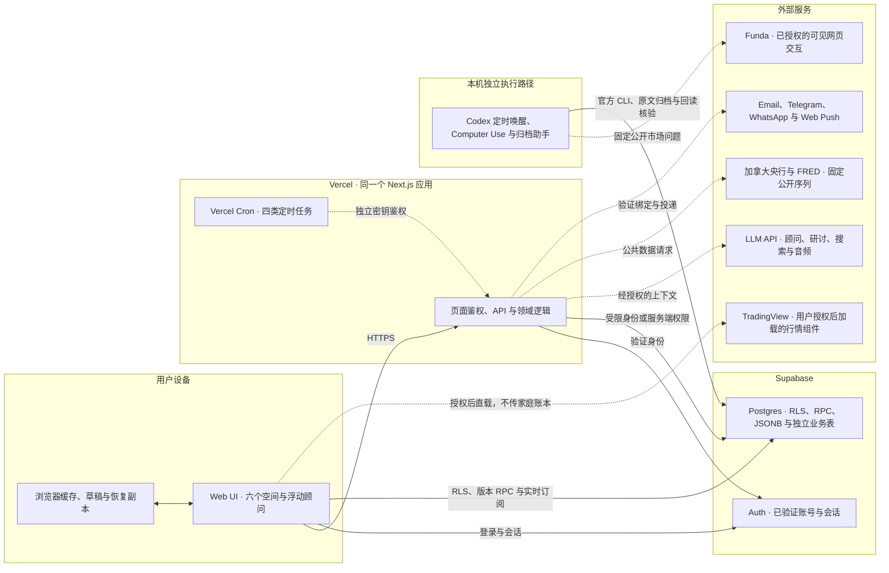
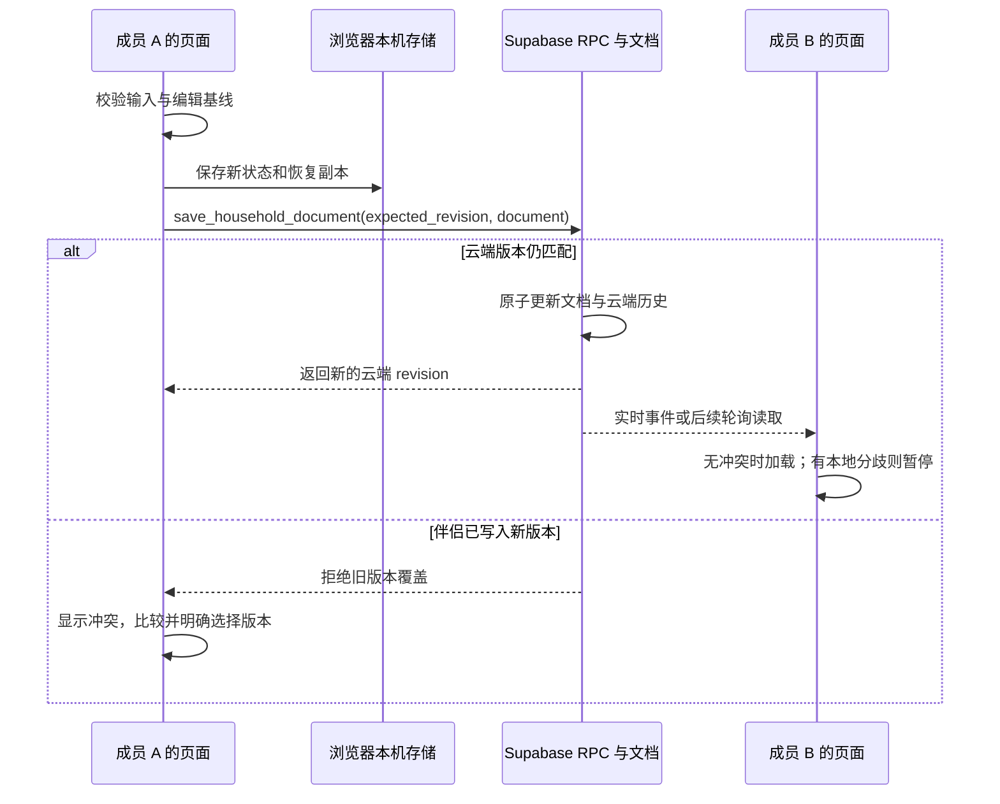

# Together · 当前系统架构

> 架构快照：2026-10-18 · 应用版本 `0.10.0` · 代码基线 `ad574f3`。本文描述当前仓库实现，不代表所有外部服务均已配置或在线可用。最后一节单独列出未来建议，避免与已实现能力混淆。

后续实施：`0.11.0` 的独立行动聚合、保守三向同步、有界跨模块导出与迁移校验见 [第一轮实施记录](next-stage.md)。下方图示保留为上述基线快照，不把后续代码完成等同生产已部署。

研讨后续：`0.12.0` 增加独立的个人研讨整理表与全文检索 RPC；`0.13.0` 新增 `lib/council-workflow.ts`、流程编辑器与 `supabase/council-workflows.sql` 增量封装。自定义环节/任务/模型子集随每轮 JSON 冻结，数据库构建有界步骤，稳定 `phase_id` 决定前序快照与导航；相同类型可重复且同环节模型互不可见。复用流程不复制材料，不扩张工具或家庭数据权限；具体协议与验证边界见 [研讨文档](council.md)。

`0.14.0` 增量：`lib/council-cost.ts` 根据步骤用量和调用时公开价格快照计算费用，联网回执包含独立搜索计费；均延用本人研讨JSON/RPC。`lib/freedom.ts` 为确定性规划计算，假设保存在家庭文档 `plan.values.financial_freedom_v1`，与资产／预算共用财务并发边界，顾问只读已保存计划。无新增数据表、工具权限、付费定时任务或自动账本写入；详见[设计与限制](freedom-and-council-costs.md)。

`0.14.1`：家庭文档的`preferences.learningSchedule`独立控制心理学卡片轮播与每日提醒，默认暂停；首页、学习页与每日发送服务共用语义。个人收藏／提醒订阅仍在原独立表，恢复家庭轮播不会替个人订阅。定时检查保留，服务端仅投影读取开关，暂停／未知时不发送；无新SQL，不影响Funda、市场日报或周报。

## 1. 一分钟理解

Together 是面向两位授权家庭成员的 **Next.js 模块化单体应用**：一个 Web 应用承载家庭财富、市场研究、多模型研讨、学习收藏和兴趣生活；部署在 Vercel，身份和持久数据位于 Supabase。

- **一个入口，多个空间**：统一搜索、个人置顶、最近使用和关联入口连接六个主空间；家庭首页做聚合，不再复制一套业务数据。
- **共享与个人分开**：家庭账本、规划和 DJ 元数据共享；研讨记录、导航偏好、学习收藏按本人隔离。
- **确定性计算在前，AI 解释在后**：余额、贡献、图表、目标与压力试算来自应用计算；AI 不直接写数据库、不执行交易。
- **两条运行路径**：日常页面/API/提醒运行在云端；Funda 自动研究依赖本机 Codex、已连接 Chrome 和有效登录，不是云端常驻采集器。

当前不是微服务、不是券商交易系统，也不是任意工具权限的自主 Agent 平台。

## 2. 系统全景图

静态图无需 Mermaid 支持；下方源码可在 GitHub 等支持 Mermaid 的阅读器中展开。两者表达同一组运行关系，框内是逻辑边界，不表示各模块独立部署。



图中实线表示应用请求或受权限约束的数据访问，虚线表示第三方调用或定时触发。浏览器直连 Supabase 是真实实现，必须经过登录身份、RLS 或受限 RPC；不是所有请求都经过 Next.js API。

<details>
<summary>查看可编辑的 Mermaid 架构图源码</summary>



</details>

图源：[Graphviz 源文件](diagrams/architecture.dot) · [静态 SVG](diagrams/architecture.svg)。图省略了内部函数调用、HTTP 返回和独立部署流程；各域细节见下文。

## 3. 产品空间与前端组织

| 空间 | 路由 | 职责 | 主要数据来源 |
| --- | --- | --- | --- |
| 家庭首页 | `/space` | 当前状态、最多三项下一步、本人最近使用、空间入口 | 从已保存家庭状态派生，结合个人导航与精选学习目录 |
| 家庭财富 | `/` 与 hash | 资产负债、估值、现金流、出资、增长计划、季度复盘、历史、顾问 | 共享 `WealthState` |
| 市场投资 | `/markets` | 自选涨跌、宏观、情绪、AI 产业代理、研究笔记、账户关联、日报与归档 | 官方序列、外部行情组件、共享配置及研究表 |
| 多模型研讨 | `/council` | 多方回答、质询、核查、答辩、修订、可选裁判与继续追问 | 本人研讨记录、显式选择的附件和公开检索 |
| 学习成长 | `/learn` | 每日精选心理学模型、收藏、回看与订阅 | 代码内版本化目录 + 本人学习偏好 |
| 兴趣生活 | `/lifestyle` | DJ 曲库、Set、Cue、练习记录、rekordbox 交换 | 共享 DJ 元数据 + 本机音频计算 |
| 更新记录 | `/updates` | 版本、发布说明与已知限制 | `package.json`、`lib/releases.ts`；授权管理员可见 |

`app/layout.tsx` 提供全局 `NavigationProvider`；`AppNavigation` 和 `lib/navigation.ts` 共用固定功能目录。搜索只匹配页面/功能的名称和关键词，不查询资产、聊天或附件，也不保存搜索词。置顶优先，其余按最近使用排序；这不是打开 App 时强制跳转到最后一个页面。

没有明确目标的登录默认进入 `/space`，已有目标链接继续返回原路由；`/` 仍是财富工作台，旧 hash 深链接保留。关联入口只导航或准备草稿，不自动把家庭资料发送到研讨。

前端用 React、TypeScript、Recharts、Lucide 和共享 CSS。`useWealth` 被相关页面复用，但不是全站唯一的 React 状态 Provider；跨页面/设备的一致性依赖存储、版本检查和同步流程。`homeSnapshot` 等纯函数只派生视图，不维护第二份“首页账本”。

参考：[导航设计](navigation.md)、[共同维护工作台](household-workspace.md)。

## 4. 数据架构与归属

### 4.1 家庭主文档

当前共享业务的主要事实源是 `household_documents.document` 中的 **`WealthState` v3 JSONB 文档**，不是每个 UI 模块各有一张事实表。

```text
WealthState
├── members / assets / debts / contributions / budget / goal
├── history                       财务变更完整快照
├── plan                          家庭规则与检查项
├── messages / chatCurrent / chatArchives
└── preferences
    ├── model / webSearch / charts
    ├── marketWatchlist / marketResearch / portfolioLinks
    ├── growthPlan / quarterlyReviews
    └── lifestyle                 曲库、Set、Cue、练习元数据
```

上述偏好名里的 `preferences` 不代表全部是个人设置：例如自选、账户关联和 DJ 内容随家庭文档共享。个人导航和学习收藏则是独立存储。

### 4.2 运行时表与责任

| 数据域 | 表或存储 | 归属及作用 |
| --- | --- | --- |
| 身份与成员 | `auth.users`、`households`、`household_members`、`wealth_shared_home` | Supabase 身份、家庭成员、唯一共享家庭映射 |
| 共享文档 | `household_documents`、`household_document_history` | 当前完整文档、云端 revision 和历次文档版本 |
| 历史邀请机制 | `household_invites` | 旧邀请/RPC 机制；当前双成员流程自动连接共享家庭 |
| 个人导航 | `wealth_navigation_preferences` | 本人的功能访问时间和置顶，不进入家庭 JSON 备份 |
| 个人研讨 | `wealth_council_runs`、`wealth_council_quota` | 本人问题、附件表示、轮次、模型快照、工具回执与配额 |
| 个人学习 | `wealth_learning_preferences`、`wealth_learning_deliveries` | 本人收藏/订阅、带目的地去重的投递记录 |
| 市场日报 | `market_daily_briefings` | 按日共享的公开序列分析、原子生成认领与保存状态，不含家庭账本 |
| Funda 研究 | `wealth_research_archive`、`wealth_research_runs` | 家庭私密原文归档，以及交易日/开收盘的单次认领 |
| 通知 | `advisor_alerts`、`wealth_push_subscriptions` | 家庭洞察/周报/复盘提醒与个人设备订阅 |
| 外部渠道 | `wealth_notification_channels`、`wealth_channel_links`、`wealth_channel_events`、`wealth_channel_requests`、`wealth_channel_deliveries` | 本人验证绑定、加密目的地、事件/投递去重与限流；聊天归档写入共享家庭文档 |
| 模型请求限流 | `wealth_advisor_requests`、`wealth_voice_requests` | 数据库原子限流，不仅靠单个服务器进程内存 |
| 浏览器本机 | localStorage / sessionStorage；部分 IndexedDB | 家庭缓存与恢复、未发送草稿、设备 UI 偏好；可选只读 XML 文件句柄 |

早期 `schema.sql` 还定义了 `assets`、`asset_snapshots`、`goals`、`advisor_conversations` 等规范化表；当前财富 UI 的主存储读写走 `household_documents`。不要因 SQL 文件里有这些表，就把它们画成当前逐项 CRUD 的主事实源。

### 4.3 保存、同步与冲突



本机 key 为 `together-wealth-v3`，另有恢复、迁移前副本和云端连接元数据。本机保存成功与云端同步成功是两个状态；`localhost` 和生产域名的 localStorage 不共享。Supabase 文档 revision 与文档内部 revision 各有用途，不能混当同一个计数。

`save_household_document` 使用预期云端版本做乐观并发控制；不同设备有分歧时不静默覆盖。实时 UPDATE 订阅、窗口恢复可见/聚焦和约 5 秒轮询共同检查更新。它不是字段级 CRDT，也不是自动合并所有并行编辑。

本机 `storage` 事件处理同一浏览器不同标签页的更新；保存失败保留当前内容并明确提示。Service Worker 负责推送与通知导航，不提供完整离线页面缓存，因此 local-first 数据不等于完整离线 PWA。

家庭 JSON 备份包含主文档，**不等于整个 Supabase 的完整备份**：个人研讨、导航、学习、研究归档和投递表不在同一文件里。财务 `history` 记录业务快照，云端 `household_document_history` 记录文档版本，两者并不相同。

代码入口：[wealth.ts](../lib/wealth.ts)、[storage.ts](../lib/storage.ts)、[useWealth.ts](../lib/useWealth.ts)、[cloud.ts](../lib/cloud.ts)、[cloud-plan.ts](../lib/cloud-plan.ts)。

## 5. 各模块如何联动

### 财富 → 计划 → 复盘

资产/负债生成净资产和类别/成员占比；出资与资产归属分开计算。关联出资只应用对应差额，避免重复增加估值。本年回报是可编辑的记录百分比，不自动修改资产价值。

现金流驱动月结余、应急金参考和目标储蓄节奏；增长计划、季度复盘和主动洞察使用同一批事实。目标基线和压力试算是条件计算，不是模型预测或收益承诺。季度复盘保存双方意见、检查项和下一步，提醒另走投递系统。

### 市场 → 家庭暴露 → 讨论

市场有三条不同的数据链，不能混为“实时数据库行情”：

1. **服务端官方序列**：加拿大央行 Valet 提供日均汇率，FRED CSV 提供美债、CPI、GDP、就业、VIX/VIX3M、初请、住宅许可和 AI 产业代理。固定序列请求不携带家庭资料，公开结果缓存约 300 秒。
2. **浏览器 TradingView 组件**：用户授权后加载股票/ETF/汇率的外部组件，供应商控制覆盖、延迟和显示。App 不抓取跨域组件价格，不把组件载入成功当报价成功，也不将其写成券商持仓收益。
3. **研究内容**：每日市场简报使用固定公开观测值，按多伦多日期认领、生成和归档；AI 不可用时明确保留规则摘要。Funda 原文另表归档，始终标为 AI 未独立核验，不混入官方历史曲线。

账户关联用用户确认的比例，把 CAD 估值映射到证券及明确外币暴露。压力试算将冲击映射到假设净资产、目标差额和计划留存；不自动改账，不推定 ETF 穿透、实时份额、成交成本或今日 P&L。顾问可在适用问题下读取固定官方资料与已保存关联，再解释家庭影响。

AI 产业数据是美国广义电子订单、半导体/元件产出和利用率的**代理指标**，不是 GPU、HBM 或全球 AI 供需的直接测量。

入口：[市场服务](../lib/market-server.ts)、[市场分析](../lib/market-analysis.ts)、[账户关联](../lib/portfolio-links.ts)、[日报生成](../lib/market-briefing-server.ts)。详见 [市场看板](market-dashboard.md)、[市场与家庭联动](market-wealth-learning.md)。

### 兴趣 → 本机计算 → 共享元数据

DJ 的 CSV/JSON/rekordbox XML 在浏览器解析、预览、确认后入库；曲序和下一首由 BPM、调性、能量及个人偏好等启发式评分决定，不依赖 LLM。音频通过本机解码、Web Worker 和能量分析产生 Cue 候选，用户试听确认后保存的是元数据，音频不上传、不持久保存。

rekordbox 是 XML 交换和可选只读文件变化检测，不是直接连接其数据库、实时双向同步或完整音频备份。参见 [DJ 系统](lifestyle.md)、[智能编排与 Cue](dj-smart.md)、[rekordbox 边界](rekordbox.md)。

## 6. AI 架构：顾问与研讨是两条产品链

### 6.1 浮动财富顾问

`FloatingAdvisor → /api/advisor → 身份/配额 → 路由/可选查证 → 回复及修改提案 → 用户确认 → 家庭状态提交`。

`lib/ai/router.ts` 使用关键词和问题长度评估 `simple / standard / complex`，不是另调一个付费分类模型。自动模式的日常/标准问题优先 DeepSeek，复杂规划优先 OpenAI 深度档，再按已配置 provider 选可用候选；用户也可手动选择。模型 ID 可由服务端变量覆盖，实际权限取决于服务商。选择候选与请求失败后的自动重发不是一回事；不应把超时当成“未计费”。

浮动顾问目前只挂载于财富页；其他空间的 `/#advisor` 入口返回财富页打开，不是全站常驻聊天组件。`/api/advisor` 接收客户端在提交时构建并经 schema 校验的快照，并非每次从服务器重读家庭文档。顾问使用其中家庭事实和所选对话的有界上下文，不自动加入 DJ 或研讨历史；聊天及归档随家庭文档共享保存。

修改先经 `advisor-actions` / `advisor-preview` 校验，展示前后差异；用户确认时再次检查基线，才一次性保存并记历史。假设题不改账，重名、无效值或过期编辑需重新确认。不同调用链的重试策略并不相同：普通 OpenAI 顾问 SDK 当前允许一次重试，不能把研讨/搜索的严格“不自动重发”泛化为全站保证。

可选联网查证是另一项 OpenAI Responses `web_search` 请求；顾问模式将问题映射到固定公共金融主题，只发送公开查询，不发送家庭账本或原始私人聊天。查证后的回答仍可由 DeepSeek 生成；联网回答的修改动作强制为空。没有外部模型时可明确降级为本地规则助手。

### 6.2 多模型研讨

`/api/council`、`lib/council-server.ts` 和相关纯函数实现应用自己的研讨状态机。可选 provider 包括 OpenAI、Anthropic、DeepSeek、Qwen、GLM、Moonshot、Gemini、Muse Spark；部分 Kimi/GLM 型号可经已核实的百炼映射调用。具体型号、渠道、兼容能力在运行开始时冻结，历史不随后续默认配置变更。

| 模式 | 本轮流程 | 基础模型调用预算 |
| --- | --- | --- |
| 标准研讨 | 独立回答 → 交叉质询 → 修订 | `3 × N + 可选裁判` |
| 深入研讨 | 独立回答 → 交叉质询 → 证据核查 → 逐项答辩 → 修订 | `5 × N + 可选裁判` |
| 直接追问 | 各模型直接回答 → 可选裁判 | `N + 可选裁判` |

`N` 为本轮参与模型数，工具搜索另有成本。追问可继续相互研讨，不重复执行旧轮次；旧记录保留原预算。每阶段上下文固定，模型不偷看同阶段尚未结束的回答。支持的模型启用匹配的原生推理参数，但不把内部思维链当作用户可审计证据。

执行由浏览器驱动逐步推进；服务端先原子认领任务，再调用供应商、解析流、保存结果并推送进度。数据库保存状态不等于有一个持久后台 Worker：关页后不再安排后续步骤，已受理请求仍可能完成或计费。请求状态不明时暂停并显式处理，不自动重新发起有费用的任务。

研讨历史按本人隔离，附件与追问保存在运行记录中；**不会自动读取共享家庭账本**。用户选择材料后，文字/压缩图片才按确认范围发送给兼容的参与模型与裁判。

### 6.3 工具到底由谁提供

| 能力 | 当前执行者 | 权限/边界 |
| --- | --- | --- |
| 研讨计算器 | App 服务端的受限数字解析器 | 不使用 `eval`，无代码、Shell 或数据库执行 |
| 研讨材料检索 | App 对本轮提取文字做关键词片段检索 | 不是向量 RAG、OCR 或供应商托管 `file_search` |
| 研讨公开检索 | App 审批查询、记调用意图，再调用 OpenAI 原生 `web_search` | 只允许用户预先确认的公开查询；同轮去重、数量受限 |
| 研讨深思 | 各 provider 支持的原生推理参数 | 适配具体型号，不保证所有模型相同能力 |
| 顾问数据编辑 | App 校验器 + 用户确认 + 存储层 | 模型只提案，无直接 SQL 或交易权限 |
| Funda 浏览器操作 | 本机 Codex Computer Use | 不属于研讨模型的任意工具权限 |

研讨模型提出受控 JSON 工具计划，由 App 校验执行并回填真实回执；**不是每家模型自带工具的无限 Agent 循环**。核查阶段每位参与者最多两项请求、其中最多一次公开搜索；每轮批准的公开查询也有上限。付费联网前先持久化意图，同轮同查询即使失败/不确定也不自动重发。来源、检索时间、失败状态随历史保存，但引用本身不等于事实已验证。

此处“原生工具”与“应用执行工具”的术语参照 [OpenAI Web search](https://developers.openai.com/api/docs/guides/tools-web-search) 和 [Function calling](https://developers.openai.com/api/docs/guides/function-calling)；项目具体实现仍以 [council-tools.ts](../lib/council-tools.ts) 为准。详见 [完整研讨流程与费用边界](council.md)。

### 6.4 语音与附件

自然语音当前是“浏览器停顿检测/录音 → `/api/voice` 识别 → 文字顾问 → 神经语音合成 → 继续收音”的半双工流程，不要求预选语种。它不是 Realtime WebRTC 原生全双工语音；播报期间暂停收音，修改提案暂停等待页面确认。录音/合成音频只在请求和内存中使用，文字沿用聊天保存；App 不留音频不代表供应商零保留。

研讨图片在本机处理后保存压缩表示；PDF.js / DOCX 解包器提取文字，原文件并非完整上传保存。扫描件、图表和文字提取不全的资料需另附截图；当前没有自动 OCR、向量数据库或通用知识库索引。参考 [自然语音](natural-voice.md) 与 [研讨附件限制](council.md)。

## 7. 主动任务与外部渠道

页面内规则洞察来自已保存的家庭事实；定时 AI 周报只发送所需汇总和观察，不发送历史聊天或执行改账。每日学习是版本化精选内容轮换，不是每天让模型编造研究。外部推送遵循个人订阅、验证绑定及渠道能力；平台接受发送不等于用户已读。

| 云端入口 | `vercel.json` 调度（UTC） | 内容 |
| --- | --- | --- |
| `/api/advisor/digest` | 周一 13:00 | 家庭主动复盘/周报 |
| `/api/market/briefing/daily` | 每日 14:00 | 固定公开序列市场简报 |
| `/api/learning/daily` | 每日 15:00 | 已订阅的心理学学习提醒 |
| `/api/review/reminders` | 每日 16:00 | 按复盘状态判断是否需要季度提醒 |

上述是计划触发时间，不是准确送达承诺；UTC 不随多伦多夏令时改变。各处理器再执行自己的日期、订阅、认领和去重逻辑。Cron 使用 `CRON_SECRET` 独立鉴权，不依赖浏览器登录。

Email、Telegram、WhatsApp 和 Web Push 有不同配置条件：SMTP、平台 token/签名、VAPID、模板或平台会话窗口等。Email 当前只发信，不读取收件箱、不支持邮件对话。Telegram/WhatsApp 的 webhook 校验及绑定验证独立于网页中间件；平台内是只读单顾问，不授予改账或多模型研讨权限。

渠道目的地在独立表加密保存，渠道消息则通过 RPC 写入家庭文档的 `channel-*` 对话归档，**伴侣也可见**；它不是本人私有消息，也不是网页当前会话的实时镜像。周报支持各类已配置渠道；学习提醒支持 Push/Email/Telegram；季度提醒当前为 App 内与 Email/Telegram；市场日报只生成存库，没有对应外部推送流程。微信尚未实现正式接入。详见 [通知配置](notifications-setup.md)。

### Funda 本机研究路径

本机定时唤醒先用 `lib/funda-runner.cjs` 检查是否到期，再执行已授权的可见网页提问、原文复制、私密归档和回读核验。开盘开始时间为多伦多 09:40；正常收盘为 16:15，官方半日市为 13:15，各有受限执行窗口；固定交易日历覆盖 2026–2028，异常休市仍需核对。当前保存的是原文历史库，未自动抽取并核实为结构化趋势数值。

每家庭/交易日/时段只能认领一次；提交状态不明不得自动重问。运行依赖 Mac 醒着、联网、Codex 运行、Chrome 可连接、Funda 及本机管理授权有效。助手通过已安装的官方 Supabase CLI 归档，不提取浏览器凭证、不调用未公开接口，不发送家庭资产/成员/项目文件，也不把原文再转给其他模型。授权范围和完整操作见 [Funda 运行手册](funda-recurring.md)。

## 8. 安全、隐私与密钥边界

1. **页面层**：`middleware.ts` 用 Supabase 验证用户，要求已验证邮箱且在双账号白名单内。公开登录/恢复入口、静态资源和独立鉴权的 Cron/webhook 有明确例外。
2. **API 层**：普通业务 handler 再用 `authorizeRequest` 验证 Cookie 或 Bearer，不信任客户端提交的邮箱/user ID；不能仅凭页面中间件判断 API 安全。
3. **数据库层**：RLS、成员关系和受限 RPC 检查共享家庭或本人归属；配额/认领在数据库原子执行。`service_role` 绕过 RLS，因此使用它的服务端代码必须另外校验作用域。
4. **外部调用层**：各用途分别控制上下文；公开行情不带账本、研讨不自动带账本、网页引用和附件是数据而非可信指令。AI 结果用安全 Markdown 展示，不执行原始 HTML。
5. **编辑层**：财务提案需明确确认和版本检查；模型、公开搜索、外部渠道及 Funda 都没有任意账本写权限。

生产密钥在 Vercel 服务端环境变量；开发配置在忽略的 `.env*`，本机研究配置在忽略的 `.local`。浏览器仅使用公开 Supabase URL/anon key 和公共 Push key；`NEXT_PUBLIC_` 不能放 service role、LLM key、SMTP 密码或渠道 token。初始化密码不属于代码或环境样例。

隐私遮挡是 UI 功能，不是权限、加密或设备隔离。本机家庭缓存和 JSON 备份仍是敏感明文数据；退出登录不等于清除这些副本，需保护设备、浏览器和导出文件。两个账号均可看版本管理页不代表数据库角色都为 `owner`。当前不宣称端到端加密、供应商零保留、独立安全审计或完整灾难恢复。密码邮件由 Supabase Auth 管理；默认邮件服务有发送限制，可靠恢复依赖自定义 SMTP 配置。

## 9. 部署、验证与目录地图

```text
GitHub 源码 → Vercel 构建 → Next.js 页面、静态资源和 Route Handlers
                      ↘ 独立配置运行环境变量和 Cron
Supabase SQL 脚本 → 单独执行 → 数据表、RLS、RPC 与权限
本机 Codex / Chrome → 独立唤醒与授权 → Funda 私密研究归档
```

GitHub Actions 的 `verify.yml` 执行单元/组件测试、生产构建和隔离身份的浏览器测试；它是验证工作流，不应理解成自动应用全部数据库变更。Vercel 发布同样不会替你执行 `supabase/*.sql`。新数据库/权限能力应先按模块文档完成兼容 SQL，再发布使用该能力的代码。

开发缓存 `.next-dev`、生产 `.next`、测试 `.next-test` 分开；PDF 解析所需静态库由准备脚本生成。`.vercelignore` 排除密钥、`.local`、测试、文档和 SQL 等，因此本文是仓库文档，不会成为公开网站上的文档路由。

默认测试不发送通知、不调用付费模型、不接触真实家庭记录；真实云端/供应商检查须显式启用对应集成测试开关。测试通过不能证明所有设备、外部行情覆盖或服务商权限长期可用。验证细节见 [测试报告](../TEST_REPORT.md)。

| 位置 | 责任 |
| --- | --- |
| `app/*/page.tsx`、`app/page.tsx` | 六空间和系统页面 |
| `app/components/` | 导航、表格、顾问、市场、复盘与 DJ 交互 |
| `app/api/` | 鉴权后的业务接口、Cron 与平台 webhook |
| `lib/wealth.ts`、`storage.ts`、`cloud*.ts`、`useWealth.ts` | 共享文档、验证、持久化、同步与冲突 |
| `lib/navigation.ts`、`lib/home-space.ts` | 功能目录、首页派生与入口组织 |
| `lib/ai/`、`advisor-*.ts`、`voice.ts`、`web-search.ts` | 顾问路由、提案、语音和公开查证 |
| `lib/council*.ts` | 多模型状态机、适配、附件、流、工具与结果 |
| `lib/market*.ts`、`portfolio-links.ts`、`growth*.ts` | 公开序列、研究、家庭暴露与假设计算 |
| `lib/learning*.ts`、`quarterly*.ts`、`channel*.ts`、`push.ts` | 学习、复盘、提醒与外部渠道 |
| `lib/dj*.ts`、`rekordbox*.ts`、`lifestyle-schema.ts` | 兴趣元数据、本机分析与交换 |
| `supabase/` | 各域 SQL、RLS、RPC 和邮件模板 |
| `tests/`、`tests/e2e/`、`.github/workflows/` | 纯逻辑、组件、浏览器、数据库和可选集成验证 |
| `docs/` | 各模块的设计、配置、使用和边界说明 |

## 10. 下一阶段建议（0.10.0 基线）

`0.11.0` 已落实第一轮基础：独立行动表、有限模块合并、导出与迁移校验；全面拆表、后台队列、成本台账和通用恢复仍未实现。详细实现和部署前提以 [后续实施记录](next-stage.md) 为准。

| 优先级 | 建议 | 为何重要 |
| --- | --- | --- |
| P1 | 逐步按聚合边界拆分大型共享 JSONB，如财务事实、对话和兴趣 | 减少无关模块的版本冲突和整文档传输；迁移必须保持历史可追溯 |
| P1 | 建立版本化迁移、恢复演练和跨表导出方案 | 当前分散 SQL 与家庭 JSON 备份不能替代全系统升级/恢复 |
| P1 | 为长研讨增加持久任务队列/Worker 和幂等状态机 | 不依赖打开页面推进；保留“已受理可能计费、未知不重发”的安全边界 |
| P1 | 建立统一运行观测与成本台账 | 汇总调用阶段、来源时效、失败、重复认领和预算；避免记录敏感正文/凭证 |
| P2 | 统一跨模块的待办/决策对象 | 将市场证据、研讨结论、财富计划和季度行动建立显式关联，而非复制内容 |
| P2 | 引入有授权与许可的数据适配层 | 只有在报价来源、时效、币种、持仓份额和成本明确后，才考虑自动估值/P&L |
| P2 | 将二人白名单演化为真正的家庭租户与角色模型 | 支持更多家庭前需独立审查邀请、管理权、数据归属及隔离，不能仅删除白名单 |

演化原则：保留一个统一入口与设计系统，按真实复杂度拆分数据和后台工作；不要为“超级 App”过早拆微服务，也不要把更多卡片等同于模块已经联动。
